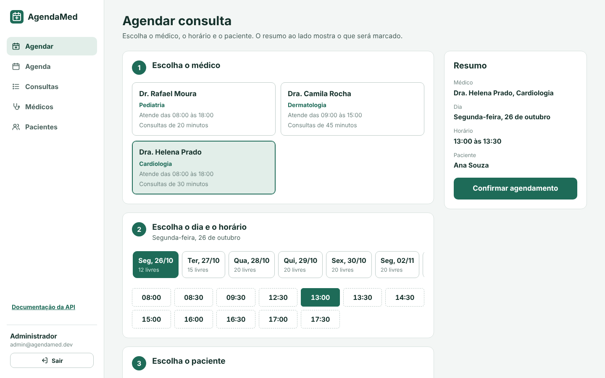
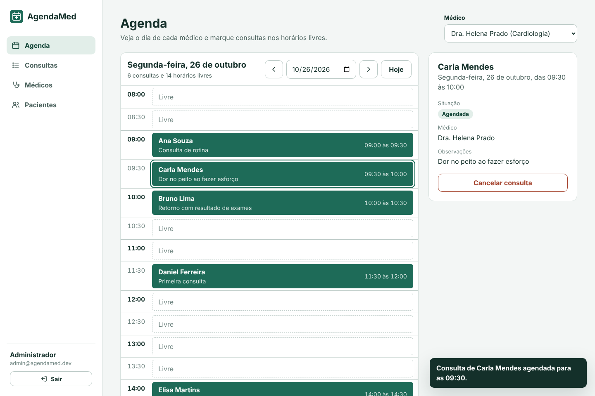
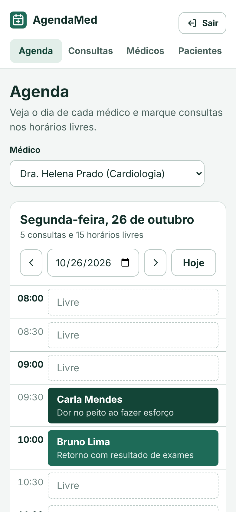

# AgendaMed 🩺

[](https://github.com/luisgustavoprata/agendamed/actions/workflows/ci.yml)


**[🔗 Demonstração online](https://agendamed-6pfk.onrender.com)** · **[📖 Documentação da API](https://agendamed-6pfk.onrender.com/docs)**

Sistema de **agendamento de consultas médicas**: uma API REST com autenticação JWT e regras
de agenda reais (expediente, grade de horários, conflitos de médico e paciente), uma
**interface web** para a recepção da clínica e uma suíte de testes automatizados rodando em
integração contínua.

> Projeto de portfólio criado para demonstrar boas práticas de engenharia de software em
> Python: arquitetura em camadas, validação de dados, segurança, testes, DevOps e front-end.



---

## 🖥️ Interface web

A API vem com uma interface pronta, servida pelo próprio Flask em `http://localhost:5000/`.
É escrita em **HTML, CSS e JavaScript puros**, sem frameworks e sem etapa de build, e consome
os mesmos endpoints documentados abaixo.

- **Entrar na demonstração**: no site publicado, um botão dá acesso imediato a uma clínica
  de exemplo, sem cadastro.
- **Agendar consulta** (tela inicial): passo a passo guiado. Escolha o médico, veja os
  próximos dias úteis com a quantidade de horários livres, toque no horário, escolha ou
  cadastre o paciente e confirme pelo resumo ao lado.
- **Agenda do dia**: o dia de cada médico em forma de régua de horários. Consultas aparecem
  como blocos, horários livres ficam tracejados e os que já passaram ficam hachurados.
  Clique em um horário livre para agendar, ou em uma consulta para ver os detalhes,
  concluir ou cancelar.
- **Consultas**: lista com filtros por dia, médico e situação, além de paginação.
- **Médicos** e **Pacientes**: busca e cadastro, com máscara de CPF e telefone e os erros de
  validação da API exibidos ao lado de cada campo.
- **Responsiva**: funciona no celular, com navegação por abas no topo.
- **Acessível**: navegação por teclado, foco visível, rótulos em todos os campos e
  confirmação em dois cliques para cancelar (sem janelas do navegador).
- **Segura**: todo texto vindo da API entra na página como texto, nunca como HTML, o que
  evita ataques de XSS.

| Agenda do dia | Celular |
|---|---|
|  |  |

---

## ✨ Funcionalidades

- **Autenticação** com cadastro, login e token **JWT** (expiração configurável).
- **Médicos** com especialidade, CRM, expediente e duração de consulta próprios.
- **Pacientes** com **validação de CPF** pelos dígitos verificadores e busca por nome ou CPF.
- **Consultas**: agendar, listar com filtros, cancelar e concluir.
- **Agenda disponível**: lista os horários livres de um médico em um dia.
- **Documentação interativa** OpenAPI 3.1 com Swagger UI em `/docs`.
- **Proteção contra força bruta** no login: após 5 senhas erradas, novas tentativas são
  bloqueadas por 5 minutos (resposta `429` com o cabeçalho `Retry-After`).
- Paginação, respostas de erro padronizadas em JSON e mensagens em português.

## 📏 Regras de negócio

| Regra | Resposta |
|---|---|
| Não é possível agendar no passado | `422` |
| Médicos não atendem aos fins de semana | `422` |
| A consulta precisa caber no expediente do médico | `422` |
| O horário segue a grade do médico (ex.: de 30 em 30 min a partir das 08:00) | `422` |
| Um médico não pode ter duas consultas ao mesmo tempo | `409` |
| Um paciente não pode ter duas consultas ao mesmo tempo, mesmo com médicos diferentes | `409` |
| Só consultas agendadas podem ser canceladas, e antes de começarem | `409` |
| Só consultas que já começaram podem ser concluídas | `409` |

Os horários são tratados como **intervalos semiabertos** `[início, fim)`: uma consulta das
09:00–09:30 não conflita com outra das 09:30–10:00.

## 🏗️ Arquitetura

```
agendamed/
├── __init__.py          # application factory (create_app)
├── config.py            # configuração via variáveis de ambiente
├── db.py                # conexão SQLite, transações e comandos CLI
├── schema.sql           # tabelas, restrições e índices
├── models.py            # entidades de domínio (dataclasses imutáveis)
├── schemas.py           # validação de entrada com Pydantic
├── repositories.py      # acesso a dados (todo o SQL fica aqui)
├── security.py          # hash de senha PBKDF2 e tokens JWT
├── errors.py            # erros de domínio → respostas HTTP
├── openapi.py           # especificação OpenAPI gerada a partir dos esquemas Pydantic
├── ratelimit.py         # limite de tentativas de login (janela deslizante)
├── seed.py              # dados de demonstração
├── services/
│   ├── scheduling.py    # regras de agenda puras (sem banco, sem relógio)
│   └── appointments.py  # casos de uso: agendar, cancelar, concluir, disponibilidade
├── routes/              # blueprints HTTP (auth, doctors, patients, appointments, docs)
└── static/              # interface web: index.html, styles.css e app.js
```

O fluxo de uma requisição é **rota → serviço → repositório → banco**. Cada camada tem uma
responsabilidade só, o que torna o código fácil de testar e de evoluir (por exemplo, trocar
o SQLite por PostgreSQL mexe apenas nos repositórios).

### Decisões técnicas

- **Regras de agenda como funções puras.** `services/scheduling.py` não acessa banco nem
  relógio, então é testado de forma unitária, rápida e determinística.
- **Relógio injetável.** O "agora" vem de `app.config["CLOCK"]`. Nos testes ele é fixado,
  o que permite simular a passagem do tempo sem `sleep` nem testes instáveis.
- **Proteção contra agendamento duplicado concorrente.** A checagem de conflito e a
  inserção rodam na mesma transação `BEGIN IMMEDIATE`. Assim, duas requisições simultâneas
  não conseguem reservar o mesmo horário.
- **Segurança.** Senhas com PBKDF2-HMAC-SHA256 (600 mil iterações, recomendação OWASP),
  comparação em tempo constante, mesma mensagem para "e-mail inexistente" e "senha errada",
  limite de tentativas de login por IP e e-mail, cabeçalhos de segurança HTTP
  (Content-Security-Policy, X-Frame-Options, X-Content-Type-Options) e container Docker
  rodando sem root.
- **Documentação que não desatualiza.** Os corpos de requisição da especificação OpenAPI
  vêm dos mesmos esquemas Pydantic que validam a API, e um teste falha se alguma rota nova
  for criada sem documentação.
- **Fuso horário da clínica.** O servidor pode rodar em UTC (como no Render), mas "agora" é
  sempre calculado no fuso da clínica (`CLINIC_TIMEZONE`, padrão `America/Sao_Paulo`).
- **Integridade no banco também.** `UNIQUE`, `CHECK` e chaves estrangeiras garantem os dados
  mesmo que alguém escreva direto no banco, e os índices cobrem as consultas de agenda.

## 🚀 Como rodar

### Localmente

```bash
python -m venv .venv
source .venv/bin/activate          # no Windows: .venv\Scripts\activate
pip install -r requirements-dev.txt

flask --app agendamed seed         # opcional: cria dados de demonstração
flask --app agendamed run --debug  # http://127.0.0.1:5000
```

Abra **http://127.0.0.1:5000** no navegador para usar a interface web. O comando `seed` cria
o usuário **admin@agendamed.dev** com a senha **admin12345**, além de três médicos, seis
pacientes e uma agenda de consultas para os próximos dias úteis. Na tela de login, o botão
"Preencher dados de demonstração" já coloca esse usuário e senha.

### Com Docker

```bash
cp .env.example .env               # defina uma SECRET_KEY
docker compose up --build          # http://localhost:8000
```

### No Render (deploy na nuvem, plano gratuito)

[](https://render.com/deploy?repo=https://github.com/luisgustavoprata/agendamed)

O arquivo `render.yaml` descreve o serviço como código (*infrastructure as code*): imagem
Docker, verificação de saúde em `/health`, chave secreta gerada automaticamente e dados de
demonstração criados na inicialização. Com o repositório no GitHub, basta clicar no botão
acima (troque `luisgustavoprata` pelo seu usuário) ou, no painel do Render, escolher
**New → Blueprint** e selecionar o repositório.

No plano gratuito, o servidor "dorme" após 15 minutos sem acesso e leva cerca de 1 minuto
para acordar, e o disco não é permanente: a cada reinício o banco volta aos dados de
demonstração, com datas sempre relativas ao dia atual.

## 📡 Endpoints

| Método | Rota | Descrição |
|---|---|---|
| `POST` | `/auth/register` | Cria um usuário |
| `POST` | `/auth/login` | Retorna o token de acesso |
| `GET` | `/auth/me` | Dados do usuário logado |
| `POST` / `GET` | `/doctors` | Cadastra / lista médicos (`?specialty=`) |
| `GET` | `/doctors/{id}` | Detalhes de um médico |
| `GET` | `/doctors/{id}/availability?date=AAAA-MM-DD` | Horários livres no dia |
| `POST` / `GET` | `/patients` | Cadastra / lista pacientes (`?q=` nome ou CPF) |
| `GET` | `/patients/{id}` | Detalhes de um paciente |
| `POST` / `GET` | `/appointments` | Agenda / lista consultas (`?doctor_id= &patient_id= &date= &status=`) |
| `GET` | `/appointments/{id}` | Detalhes de uma consulta |
| `POST` | `/appointments/{id}/cancel` | Cancela uma consulta |
| `POST` | `/appointments/{id}/complete` | Conclui uma consulta |
| `GET` | `/health` | Verificação de saúde da aplicação |

Todas as rotas, exceto `/auth/register`, `/auth/login` e `/health`, exigem o cabeçalho
`Authorization: Bearer <token>`. As listagens aceitam `limit` (máx. 100) e `offset`.

A documentação completa e interativa, com exemplos e esquemas de cada requisição, fica em
**`/docs`** (Swagger UI). A especificação em JSON fica em `/openapi.json`. Para testar as
rotas protegidas pelo Swagger, faça login em `/auth/login`, copie o `access_token` e clique
em **Authorize**.

### Exemplo de uso

```bash
# 1. Login
TOKEN=$(curl -s -X POST localhost:5000/auth/login \
  -H "Content-Type: application/json" \
  -d '{"email": "admin@agendamed.dev", "password": "admin12345"}' | jq -r .access_token)

# 2. Horários livres da médica 1
curl -s "localhost:5000/doctors/1/availability?date=2030-01-08" \
  -H "Authorization: Bearer $TOKEN"

# 3. Agendar
curl -s -X POST localhost:5000/appointments \
  -H "Authorization: Bearer $TOKEN" -H "Content-Type: application/json" \
  -d '{"doctor_id": 1, "patient_id": 1, "start_at": "2030-01-08T14:00", "notes": "Retorno"}'
```

Resposta:

```json
{
  "id": 4,
  "doctor": { "id": 1, "name": "Dra. Helena Prado" },
  "patient": { "id": 1, "name": "Ana Souza" },
  "start_at": "2030-01-08T14:00",
  "end_at": "2030-01-08T14:30",
  "status": "scheduled",
  "notes": "Retorno"
}
```

Erros seguem sempre o mesmo formato:

```json
{
  "detail": "Dados inválidos.",
  "errors": [{ "field": "cpf", "message": "CPF inválido." }]
}
```

## 🧪 Testes

```bash
pytest --cov                       # testes + relatório de cobertura
ruff check .                       # lint
```

São **54 testes** entre unitários (regras de agenda, validação de CPF) e de integração (API
completa, interface web, documentação e segurança, contra um banco SQLite temporário e
isolado por teste). O GitHub Actions roda lint, testes em Python 3.12 e 3.13 e o build da
imagem Docker a cada push.

Destaque: `tests/test_concurrency.py` dispara **10 requisições simultâneas** para o mesmo
horário e confirma que só uma é aceita. Sem a transação `BEGIN IMMEDIATE`, o mesmo teste
termina com 10 consultas duplicadas, então ele realmente comprova a proteção.

## 🗺️ Próximos passos

- PostgreSQL e migrações de banco
- Perfis de acesso (recepção, médico, administrador)
- Lembretes de consulta por e-mail ou WhatsApp
- Lista de espera para horários cancelados
